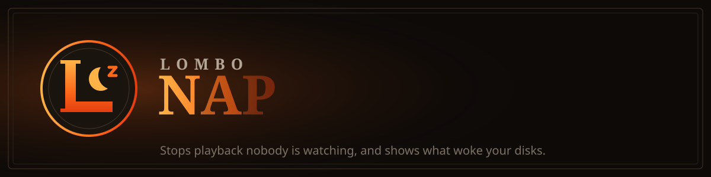

<p align="center"></p>

<p align="center">
  <a href="LICENSE"></a>
  <a href="https://github.com/Lombo-Forge/lombo-nap/actions/workflows/ci.yml"></a>
  <a href="https://github.com/Lombo-Forge/lombo-nap/actions/workflows/codeql.yml"></a>
  <a href="https://github.com/Lombo-Forge/lombo-nap/releases"></a>
  
  <a href="https://ko-fi.com/datlombardo"></a>
</p>

# LomboNap

For Jellyfin: asks "Still watching?" on a TV that has played for hours with nobody touching it, stops playback if nobody answers, and reports what woke your hard disks from spin-down.

```text
$ lombo-nap plan
alice on Living room TV (Some Show - Pilot): no interaction for 171 min, 4 title(s) in a row, would be asked in 9 min
(a plan sees one moment: counting starts when the app first sees a session)
```

## Contents

- [Install in a minute](#install-in-a-minute)
- [Commands](#commands)
- [Settings](#settings)
- [Plugging it into your own admin page](#plugging-it-into-your-own-admin-page)
- [The disk wake report](#the-disk-wake-report)
- [What is not verified](#what-is-not-verified)
- [FAQ](#faq)
- [More documentation](#more-documentation)
- [Contributing and licence](#contributing-and-licence)

## Install in a minute

1. In Jellyfin, open Dashboard > API Keys and create a key for LomboNap.
2. Copy `.env.example` to `.env` and fill in the URL and key.
3. Start it:
   ```sh
   docker compose -f compose.example.yaml up -d
   docker compose -f compose.example.yaml exec lombo-nap lombo-nap doctor
   ```

It starts in dry-run mode: it only logs what it would send and stop. Watch the log for a day (`docker compose logs lombo-nap`), then set `LOMBO_NAP_DRY_RUN=false`. The disk wake report is separate and runs on the host, see [setup](docs/setup.md).

## Commands

| Command | What it does |
|---|---|
| `lombo-nap doctor` | Checks your settings, that Jellyfin answers, the key works and sessions can be read. Exit code 1 if anything fails. |
| `lombo-nap plan` | Shows who is playing, how long they have been quiet and what would happen. Never changes anything. |
| `lombo-nap status [--json]` | Shows what the running app is tracking (who, how long quiet, time left), read from the status file. Needs `LOMBO_NAP_STATUS_FILE`. |
| `lombo-nap run [--loop]` | Counts, asks and stops. Without `DRY_RUN=false` it only logs. `--loop` repeats every `LOMBO_NAP_POLL_SECONDS`. |
| `lombo-nap wake sample` | Records the disks' power state and which processes did I/O. Run it every minute on the host. |
| `lombo-nap wake report [--days N]` | Wake-ups and time asleep per disk, with the processes most likely to blame. |
| `lombo-nap wake doctor` | Checks the host gives the report what it needs (spinning disks, `hdparm`, root). |

## Settings

Everything is an environment variable, listed with defaults in [.env.example](.env.example).

| Setting | Default | Meaning |
|---|---|---|
| `LOMBO_NAP_DRY_RUN` | `true` | Log only. Nothing is sent or stopped. |
| `LOMBO_NAP_LIMIT_HOURS` | `3` | Hours without interaction before "Still watching?" (1 to 6). |
| `LOMBO_NAP_USER_LIMITS` | empty | Own limits as `name:hours` pairs, for example `alice:2,bob:4.5`. Hours may be decimal, names match in any case, each is kept between 1 and 6. Everyone else uses `LOMBO_NAP_LIMIT_HOURS`. `doctor` and `plan` show who is on which limit. |
| `LOMBO_NAP_LIMITS_FILE` | empty | A JSON file of own limits that is read again every round, so hours change without a restart. Wins over `LOMBO_NAP_USER_LIMITS` name by name. A damaged file is ignored and the last good one stays. Shape: [docs/contracts.md](docs/contracts.md). |
| `LOMBO_NAP_STATUS_FILE` | empty | A JSON file rewritten every round with what the app tracks. `lombo-nap status --json` prints it. Empty means none is written. |
| `LOMBO_NAP_GRACE_SECONDS` | `120` | Time to answer before playback is stopped. |
| `LOMBO_NAP_MAX_EPISODES` | `0` | Also ask after this many titles in a row (0 is off). |
| `LOMBO_NAP_SKIP_USERS` | empty | User names that are never asked or stopped. |
| `LOMBO_NAP_STATE_FILE` | empty | Keeps the counts across a restart (saved every round, atomically). The compose example sets it. |
| `LOMBO_NAP_WAKE_LOG` | `/var/lib/lombo-nap/wake.jsonl` | Where the wake sampler writes. |

## Plugging it into your own admin page

Nap has no web page, login or network service. A panel or script talks to it through two JSON files, shapes in
[docs/contracts.md](docs/contracts.md):

- **Change a person's hours without a restart:** write `{"version":1,"limits":{"alice":2}}` to `LOMBO_NAP_LIMITS_FILE` (write a temporary file, then rename it over the real one). It is read every round.
- **See what is tracked:** read `LOMBO_NAP_STATUS_FILE` (or run `lombo-nap status --json`): who is playing, how long without interaction, their limit and the time left until the message or the stop.
- Share both through a folder the app and your panel can both reach (a shared volume in Docker).

What stays on you, if you want it: the page itself and who may use it; a house maximum below 6 hours (clamp before writing); turning Nap off for one person without a restart (only `LOMBO_NAP_SKIP_USERS` at start); matching people by name, so a Jellyfin rename needs the file updated; a history of who was asked or stopped; and confirming that each client app really shows the message and stops (not verified here). The full list is in [contracts.md](docs/contracts.md#what-stays-on-you).

## The disk wake report

Spin-down only helps if nothing wakes the disks. `wake sample` reads `/proc/diskstats`, `/proc/mounts`, sysfs, `/proc/<pid>/io` and asks `hdparm -C` for each spinning disk's power state (that call does not wake a disk). When a disk goes from standby to active between two samples, the report lists the processes whose I/O grew in that minute, which container they belong to and which files they hold open on that disk. It is a hint, not proof: Linux does not say which disk a process's bytes went to. Setup: [docs/setup.md](docs/setup.md).

## What is not verified

Said plainly, so you can decide how far to trust it:

- It has **never been run against a real Jellyfin server with real clients**. Tests use a fake server that records the calls.
- Which client apps honour the on-screen message (`/Sessions/{id}/Message`), the stop command and the go-home command is **unconfirmed**. Some clients may ignore the message; the stop is sent after the grace period either way.
- The wake report was **not run against real disks**. Parsing is tested with fixture text and a fake `/proc` tree. Only reading the host's `/proc/diskstats` was tried on a real machine, nothing that talks to a drive.
- Reading `/proc/<pid>/io` and open files needs root; without it the report shows wakes but no suspects.
- Restarting without `LOMBO_NAP_STATE_FILE` gives every viewer a fresh count.
- The limits file and the status document were tested with files in a temporary folder, **not** with a real panel.

## FAQ

**Is it safe to try?** Yes. Dry run is the default, and `plan` never changes anything.

**Does a paused video count as unattended?** A paused video is not "playing for hours": it is asked at the limit like any other, but a pause or play press resets the count.

**What counts as the person doing something?** Pressing play or pause, picking a title by hand, a seek backwards or a big jump forward. Autoplay into the next episode and automatic intro or credits skips do not count.

**A long film?** A movie longer than the limit is allowed to finish.

**Does it work without Jellyfin?** The wake report does. The other half needs a Jellyfin API key.

## More documentation

[Architecture](docs/architecture.md) | [How it works](docs/how-it-works.md) | [Setup](docs/setup.md) | [Contracts](docs/contracts.md) | [Troubleshooting](docs/troubleshooting.md) | [Branding](docs/branding.md)

## Contributing and licence

Contribution, security and conduct rules come from the [Lombo-Forge organisation](https://github.com/Lombo-Forge/.github). Licensed under [GPL-3.0](LICENSE). Credits are in [NOTICE.md](NOTICE.md). Not affiliated with or endorsed by the Jellyfin project.
